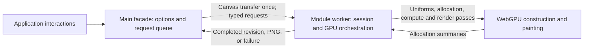

# Architecture

`await createLandscape(canvas, options)` creates a worker-owned render session.
The main entry handles options, revisions, completion promises, subscriptions,
and canvas ownership. A module worker owns the OffscreenCanvas, the device,
allocation, generation, painting, and PNG encoding. Procedural scene construction
runs in native WGSL through vgpu 0.6.0.

## Ownership and dependencies



| Module | Responsibility |
| --- | --- |
| `src/index.ts`, `src/types.ts` | Public exports and asynchronous API types |
| `src/landscape.ts` | Canvas claim, accepted options, coalescing, capture barriers, and terminal public state |
| `src/options.ts` | Option validation and backing-size limits |
| `src/runtime/connect.ts`, `protocol.ts` | Worker support probe and typed request/response messages |
| `src/runtime/worker.ts` | Worker session, ordered operations, GPU completion, encoding, and graceful shutdown |
| `src/gpu/program.ts` | Device, surface, ink target, render pipelines, failure reporting, and cleanup |
| `src/gpu/generation.ts` | Seed identity, visible chunk range, compute orchestration, bounded buffers, and allocation readbacks |
| `src/shaders/` | Planning, topology, paths, random streams, ordering, brush expansion, bounds, and rasterization |

Production host implementation is strict TypeScript; GPU implementation is
native WGSL. The runtime does not import the earlier JavaScript composition
recipes. GPU handles and generated geometry remain inside the worker/GPU
boundary. The public facade imports no GPU program or scene-construction module.

## The CPU/GPU seam

| Stage | Worker CPU | GPU |
| --- | --- | --- |
| Input | Hash the seed string; calculate the visible chunk interval; send uniforms | Initialize the seeded noise and paper tables |
| World planning | Allocate candidate storage and dispatch | Evaluate placement fields, spacing and occupancy, choose object parameters, sort painter order |
| Terrain | Allocate bounded arenas from a count summary | Construct terrain grids, contours, textures, plateaus, and decoration descriptions |
| Motifs | Allocate child arenas from a count summary; dispatch recipe families | Construct all eight tree styles, recursive branches, foliage facets, buildings, people, boats, water, huts, towers, and rocks |
| Final geometry | Allocate output buffers from a count summary | Expand child placeholders, generate brush points and bounds |
| Painting | Set view uniforms and submit passes | Paint ordered paths into the ink target, then multiply by paper |
| Capture | Ask OffscreenCanvas to encode the submitted frame and return its PNG | Finish the requested painting before capture succeeds |

No sampled control paths, vertex meshes, object descriptions, or branch topology
are generated by the host and uploaded. Host uploads consist of small uniforms
and count-buffer initialization. Regeneration reads back **three 16-byte
allocation summaries**. The worker uses their counts and overflow flag to size
buffers and decide whether construction can proceed. These readbacks contain no
coordinates, brush records, or image pixels.

## Construction pipeline

A changed seed or horizontal chunk range runs these stages:

1. **Seed initialization.** `initialize.wgsl` fills the 4096-entry noise table
   and 257 × 257 paper-decision table when the seed changes.
2. **Plan and order parents.** `plan.wgsl` plans independent 512-unit chunks.
   `allocate-parents.wgsl` compacts candidates, orders them by drawing depth,
   preserves chunk/authored order for equal-depth ties, and assigns terrain
   arenas. The first summary reports parent, command-capacity, and
   control-capacity counts.
3. **Construct terrain and describe children.** `construct-terrain.wgsl` uses
   `terrain.wgsl`, `island-decorations.wgsl`, and shared construction helpers.
   It writes terrain controls and brushes, and emits child descriptions with
   placeholders at their exact positions in the parent painting sequence.
4. **Allocate and construct children.** `allocate-children.wgsl` aggregates
   overflow and assigns disjoint child arenas. The second summary reports child
   count and required command/control capacities. Separate `construct-*.wgsl`
   entries dispatch tree, building, boat, water, hut, tower, and rock recipes.
   Terrain controls are copied between GPU buffers without CPU readback.
5. **Count and flatten.** `count-brushes.wgsl` resolves placeholder sizes and
   computes painter-prefix offsets. The third summary supplies final command
   and point counts plus overflow. `compact-brushes.wgsl` replaces each
   placeholder with its child's brushes in that position.
6. **Expand and paint.** `brushes.wgsl` constructs final brush vertices and
   bounds. `paths.wgsl` paints the ordered instances into an intermediate ink
   target. `paper.wgsl` composites its screen-aligned 512-logical-pixel paper
   tile onto the output surface.

A child queue can be populated in any GPU scheduling order. Its indices are
references, not painter order: each parent placeholder points to the correct
child, and flattening restores the authored sequence. Water's low depth key
places it behind land; later white fills provide foreground occlusion.

Planning runs per chunk and construction per object. Ordering and allocation
passes perform their required serial work on the GPU. Moving a stage to the
GPU does not imply that every operation within it runs in parallel.

### Shared construction data

`commands.wgsl` owns the storage ABI: an 80-byte `SceneObject`, a 128-byte `Brush`,
and 16-byte object-count records. Control samples use 16-byte slots, final
points use 8 bytes, and bounds use 16 bytes per brush.

`construction.wgsl` owns the `Writer`, path reservation, subdivision, curves,
paint emission, stroke profiles, blobs, texture intervals, and facet helpers.
Each writer receives its own command/control arena and random state. Recipe
modules own their topology: `trees.wgsl`, `motifs.wgsl`, `terrain.wgsl`, and
`rock.wgsl`. Explicit stacks express recursive tree growth and triangulation;
geometry needed by a later construction rule stays on the GPU.

`children.wgsl` emits descriptions and painter placeholders. `capacity.wgsl`
defines arena capacities by object family/style. Capacity exhaustion sets an
overflow flag that is propagated into an allocation summary; a partial recipe
is never accepted as a finished scene.

## Seeds, chunks, and caching

`seedHash` starts at 2166136261 and folds each Unicode code point in `String(seed)`
with `Math.imul(hash ^ codePoint, 16777619)`, returning an unsigned 32-bit value.
This is an FNV-style code-point hash, not a hash of the URL-encoded seed. The
96-character encoded-length limit only bounds public input messages.

`random.wgsl` supplies an integer hash and Xorshift32 sampling. Chunk seeds derive
from the scene hash and signed chunk index; objects and decorations receive
independent streams. GPU integer hashing fills the noise table used by the
four-octave p5 interpolation in `noise.wgsl`. It also initializes paper decisions.
The formulas retain their upstream construction roles, but the original global
random sequence and seed mapping are deliberately replaced.

The generated interval is:

```text
firstChunk = floor(cameraX / 512) - 3
lastChunk  = ceil((cameraX + width / zoom) / 512) + 3  // exclusive
```

The painting cache key is the seed hash and those two boundaries. A repeat of
that key reuses the generated brushes, points, and bounds. A changed key releases
the previous painting and generates the new range; scratch buffers are released
after generation completes. This retains one range instead of an ever-growing
history of explored chunks.

Changing only the view within a cached range repaints the ink target without
regenerating geometry. An unchanged view only composites the retained ink with
paper. A capture redraws/composites before beginning its snapshot, so browser
presentation does not leave it reading a discarded surface.

Independent chunk streams remove exploration-order dependence. Same-adapter
repeatability does not establish exact cross-adapter agreement: floating-point
noise and geometric thresholds can affect topology as well as raster pixels.
Island occupancy also derives mountain candidates from two neighboring chunks
on either side, including outside the generated range. A 500-unit mountain
jitter plus a 200-unit exclusion radius fits that neighborhood; the result is
independent of range edges and navigation history.
The [upstream studies](upstream.md) describe the original CPU/SVG program;
its global random history and old one-chunk culling policy are historical,
not this renderer's execution contract.

## Allocation and failure boundaries

The generator tracks a 512 MiB budget for its live storage buffers. Individual
buffers must fit `GPUDevice.limits.maxStorageBufferBindingSize`; device creation
does not request enlarged storage-buffer limits. The 16-byte staging readback,
render targets, vgpu/device overhead, and browser allocations are outside that
storage-budget counter. The budget is an explicit allocation guard, not a total
GPU-memory measurement.

Backing targets have a separate cap of 8,388,608 pixels, at most 8192 per axis or
the device's texture-dimension limit if lower. Both dimensions scale together.
The public visible-width limit bounds the number of requested chunks, but does
not guarantee that every dense seed fits its arenas or the device's buffers.

Planning, terrain, or decoration overflow rejects generation before a new image
is painted. Buffer-limit failures also reject rather than shrinking, sampling,
or silently truncating the scene. The worker publishes a terminal error and
releases its resources. Recovery uses a fresh canvas and a smaller view or
another seed, as described in the [API guide](../README.md#resource-limits).

## Session lifecycle and capture

Creation claims the input canvas before its first await. The new worker probes
its own WebGPU adapter before canvas transfer. Once transferred,
that canvas cannot be remounted or transferred back after disposal. Failures
before transfer leave the input available for retry; GPU setup failures after
transfer require a fresh canvas.

The facade assigns request revisions and coalesces adjacent queued renders.
Only a matching completion can settle an active request. Coalesced callers all
resolve after their replacement frame's GPU fence; the latest accepted options
may already describe a newer pending request. A `ready` session can have work in
flight.

Captures are exact queue barriers. Their options and revision are fixed when
accepted; the worker draws, snapshots the OffscreenCanvas in the submission
task, and observes both PNG encoding and GPU completion before returning it.
An encoder failure rejects only that capture. GPU/device/worker failure rejects
pending work and makes the session terminal.

`presentation: "incremental"` batches consecutive brush instances into a retained
ink attachment. Only its first batch clears; each later batch loads existing
ink, paints the next authored command interval and composites paper. Timer
yields permit cancellation and allow hidden-document captures to progress.
The final submission stays in the capture task before encoding begins.
New renders may cancel an active incremental revision if no queued capture
depends on its completion; its callers move to the replacement frame. A partial
painting invalidates the cached view so its replacement clears before painting.

Applications can pass a worker factory and an initialization AbortSignal in the
third creation argument. These main-thread settings are not serialized. Abort
terminates acquisition, compilation or first-frame painting before a handle is
returned. The signal detaches on success. The `shan-shui-gpu/worker` export is a
stable asset entry for application bundlers; the packed esbuild consumer tests
this contract under a nested base path.

Disposal immediately publishes `disposed`, rejects queued requests and an
active render, and prevents later notifications from restoring readiness. An
already-dispatched capture can finish before GPU teardown. A 30-second shutdown
bound terminates a worker whose capture does not finish. Public API details and
framework remount guidance are in the
[lifecycle guide](../README.md#lifecycle-and-browser-support).

## Build and verification

`scripts/build.mjs` resolves native WGSL imports and prepares shader reflection
with `@vgpu/wgsl`, then bundles `dist/index.js` and `dist/runtime/worker.js`
separately. The worker includes vgpu and prepared shaders. The public entry
contains only the facade and small option/protocol helpers. TypeScript emits
declarations; consumers need neither a WGSL loader nor build-time parsing tools.
`dist/options.js` supports internal Node tests.

Serve the worker asset at the URL resolved by the facade, and allow it in the
application's Content Security Policy. Building/preparing shaders does not prove
native-device validation or correct rendering.

[Verification](verification.md) owns current commands, coverage, artifacts, and
measurements. Browser instrumentation lives in a test-only worker and observes
native allocation, upload, dispatch, completion, and cleanup calls. The public
API has no test/debug transport. Upstream numeric and image fixtures retain
provenance separately from tests of the new stream mapping.

Change request semantics in the facade/protocol/worker modules; change GPU
resource lifetime in the program/generator. Change topology in the native recipe
modules and keep their ordering and arena requirements consistent with the ABI.
Edit `.wgsl` sources and rebuild instead of editing generated shader bundles.
