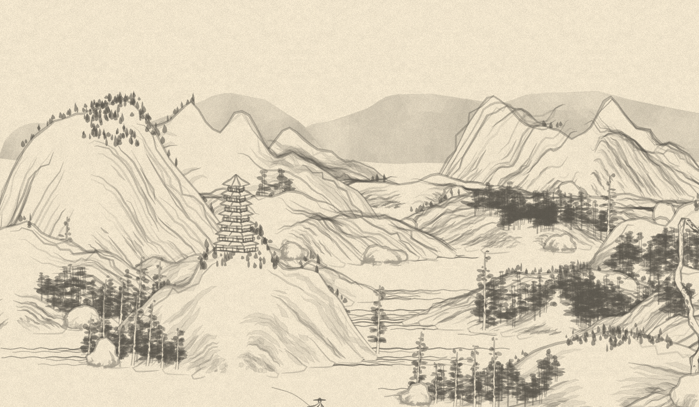
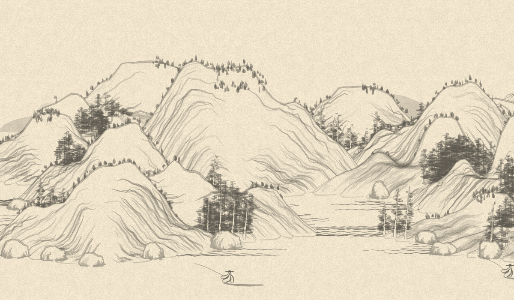

# Verification against the original

The source is LingDong-/shan-shui-inf at commit
`9f754d2b2e73495db7883d4d4055a7b0903b0454`; see [upstream provenance](upstream.md).
After establishing parity, the vendored source and source-execution harnesses
were removed. Acceptance tests now consume the independently captured data
fixtures, without downloading or installing the original implementation.

This port was built from the source studies of [terrain and planning](original-landscape.md),
[trees](original-trees.md), [motifs](original-motifs.md), and [brush primitives](original-primitives.md).
The prior approximation shader is not the reference and has been removed.

## What the comparisons establish

`npm test` exercises the actual composition factories and command recorders
against accepted outputs captured from the original in an isolated test VM. It checks the
original double-precision random stream and lazy Perlin table, scene plans,
chunk ordering, paints, direct polygons, brush controls, paper random draws,
repeated views and extensions in both directions. The production library does
not evaluate the reference HTML, modify global randomness, or upload SVG images.

`npm run test:gpu` uses actual GPU storage buffers and render targets. Its 260
noise samples differ from the original by at most `7.65e-8`. Eighteen primitive
cases contain 448 generated points; the measured maximum coordinate difference
is `0.000147` drawing units. The permitted tolerance is `0.11`, allowing one
original decimal rounding step plus float32 error. Raster probes check ordered
alpha blending, white masks, nonzero self-overlap, degenerate paths, open strokes,
butt caps, repeated vertices and miter joins. All three shader entry points also
pass native device validation with `npm run check:shaders`.

For seed `1234`, the recorded drawing contains 56,513 commands and 1,129,104 final
path points. GPU compute expands 1,048,087 of those points (92.8%); the remaining
81,017 are original polygons or plaque outlines. These counts describe the work
boundary, not a speedup measurement. CPU work still includes planning, recursive
motif construction, curve sampling and tree07's geometry-dependent triangulation.

## Whole-image comparison

Compare a fresh GPU render against the accepted original seed `1234` image:

```sh
CHROMIUM_EXECUTABLE=/usr/bin/chromium SWIFTSHADER=1 npm run compare:reference
```

The initial parity study captured three seeds (`1234`, `shan-shui`,
`quiet-morning`) and 23 individual motifs in isolated iframes. Repeated originals
reproduced their SVG and PNG exactly. The historical results appear below.
The retained image acceptance test uses fresh seed `1234`, camera `(0,0)`, scale
`1.142`, 1200×700 logical/backing pixels and the original generation range. Its
baseline in `docs/images/original-1234.png` is a native-scale crop of the original
3000×800 SVG, not a stretched image. It is not regenerated during testing.

Paired PNGs, a standalone comparison page and error metrics are written to
`test-results/comparison/`. The test fails if mean channel error reaches 3/255
or more than 3% of pixels differ by over 16/255 in any channel. Actual measured
errors are reported rather than replaced by pass/fail labels.

GPU float32 arithmetic and this renderer's 4×4 edge coverage are different from
JavaScript doubles and Chromium's SVG antialiasing. The small original “Pizza Hut”
plaque uses Liberation Sans outlines in place of browser-dependent Verdana.
Exact pixel identity is not claimed. The seed and view must match before an
image difference can be interpreted as raster error.

| Seed | Mean absolute channel error / 255 | RMS channel error / 255 | Pixels differing by >16 / 255 |
| --- | ---: | ---: | ---: |
| `1234` | 0.716 | 2.038 | 0.254% |
| `shan-shui` | 0.717 | 2.310 | 0.419% |
| `quiet-morning` | 0.871 | 2.922 | 0.747% |

### Matched seed `1234`

Original CPU/SVG output:



GPU output at the same seed and view:



Mean absolute channel error: **0.716 / 255**. Root mean square channel error:
**2.038 / 255**. Pixels with any channel difference above 16: **0.254%**.
Both images were inspected at native resolution.

The fractional-pixel-ratio regression checks exact repetition after 512 logical
pixels. A paper-only before/after comparison also confirms identical decoded
1200×700 pixels for all three seeds at pixel ratio 1; the corrected framebuffer
sampling does not change the full-size comparison images above.

## Browser and package checks

All 23 independent Chromium/WebGPU scenarios pass: distinct and repeated seeds,
Unicode/numeric seeds, cached positive/negative panning, overlapping views with
stable original object selection, fractional-ratio paper repetition, resizing,
atomic validation, real compute and upload boundaries, unchanged-view reuse,
native errors, device loss, concurrent creation, failed acquisition/compilation/
first frame, cleanup and remounting, HTML and worker PNG capture, capture races,
and demo controls, export and mobile layout.

Lifecycle fixtures use 80×64 backing pixels over a 320×256 logical view. Overlap
uses 192×64, the resize check uses 160×120 at pixel ratio 2, worker capture uses
32×24, and demo tests use pixel ratio 0.25. The full-size comparisons above are
separate; reduced-resolution lifecycle tests are not presented as visual-quality
proof. Tests instrument native WebGPU calls to verify that expanded vertices and
bounds receive no CPU uploads, and cached camera redraws upload only uniforms.

The strict build, all 17 Node tests, native shader/primitive checks and an isolated
installed-tarball consumer pass. The consumer checks public TypeScript declarations
without WebGPU ambient types, SSR import, capability probing, unchanged host
randomness, runtime-bundle identity and packaged licenses/documentation.

## Performance and limits

The checked environments use SwiftShader in Chromium and Mesa llvmpipe for
native WebGPU. They establish real shader execution and tested behavior, not
hardware acceleration or a frame-rate guarantee. Full-size dense landscapes
are expensive on these software adapters: the three 1200×700 first frames above
took 161–243 seconds under concurrent test load, including CPU composition,
compilation and GPU completion. These timings are diagnostic, not a benchmark. Hardware GPU performance remains
unmeasured.

Repeated unchanged views reuse the painted ink target; camera changes reuse
expanded geometry when the cached command list is unchanged. New regions and
seeds require CPU composition and GPU expansion. Session history affects newly
created chunks just as it does in the original. The API bounds visible width,
backing pixel count and individual GPU storage buffers; retained world chunks
still consume memory as exploration grows.

The [original chunk culling](https://github.com/LingDong-/shan-shui-inf/blob/9f754d2b2e73495db7883d4d4055a7b0903b0454/index.html#L3973-L3983) checks each
chunk's anchor against the requested range plus a 512-unit margin. It does not
test the full geometry's extent: a long distant mountain can disappear abruptly
when the camera reaches `anchorX + 512`, even while part of it would remain in
view. The port retains this upstream behavior; such a transition is distinct
from a rasterization or seed mismatch.
